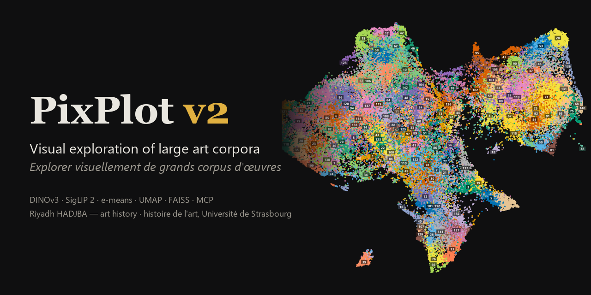
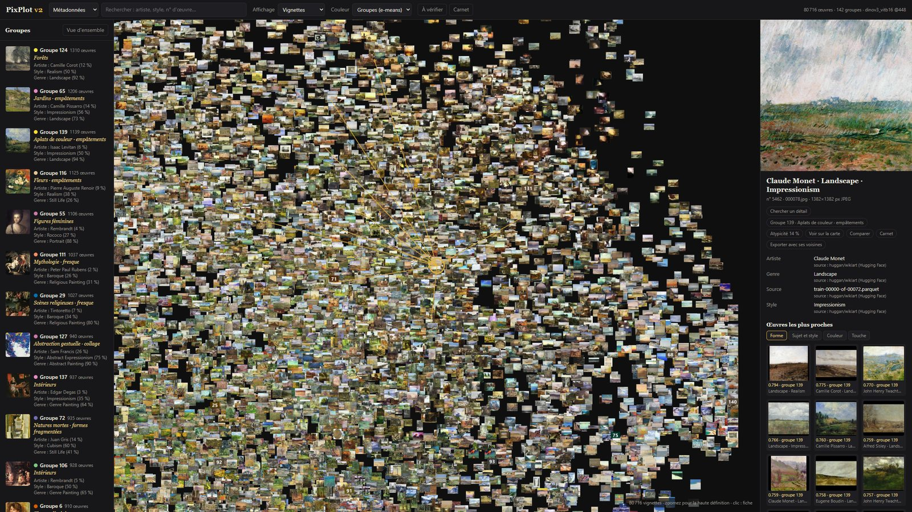

<p align="center">
  
</p>

<p align="center">
  <a href="README.md">English</a> · <b>Français</b>
</p>

<p align="center">
  <a href="LICENSE"></a>
  
  
  
  
</p>

# PixPlot v2

**Un laboratoire d'exploration visuelle pour l'histoire de l'art.** PixPlot v2 cartographie
des dizaines ou des centaines de milliers d'œuvres selon leurs ressemblances, retrouve des
parentés formelles et des détails récurrents, et transmet ses découvertes à un modèle de
langage (par MCP ou par des *Research Packs* exportables) sans jamais perdre la trace de
l'origine de chaque résultat.

> **Rôles.** PixPlot calcule, observe et organise. Le modèle de langage questionne et
> propose. L'historien vérifie, interprète et construit le savoir.

C'est une réécriture complète, inspirée du [PixPlot](https://github.com/YaleDHLab/pix-plot)
du Yale DHLab (2018), fondée sur les modèles de vision actuels et pensée pour tourner sur un
seul PC grand public.

## Tout WikiArt, sur un seul PC



**80 716 œuvres** de WikiArt (81 444 images, 33,7 Go) traitées de bout en bout en
**≈ 1 h 21** sur une AMD Radeon RX 7900 GRE, sous Windows 11, avec 16 Go de RAM : ingestion,
vecteurs DINOv3 et SigLIP 2, index de 1,58 million de zones d'image, regroupement, carte,
audit à l'aveugle et banc d'essai. Dans l'Atlas, toutes les vignettes sont à l'écran en même
temps, la carte se charge en 3 secondes environ et une recherche par texte ou par détail
répond en 0,25 s.

<details>
<summary>La carte entière : 142 groupes, en couleurs</summary>


</details>

## Ce qu'il fait

| | |
|---|---|
| **Quatre regards** | Voisines selon la **forme** (DINOv3 : formes, composition), le **sujet** (SigLIP 2 : ce qu'on décrirait avec des mots), la **couleur** (palette CIELAB) et la **touche** (facture et trait, d'après les couches intermédiaires de DINOv3). Les comparer dit *pourquoi* deux œuvres se ressemblent. |
| **Recherche** | Par métadonnées, par **description libre** en français ou en anglais (SigLIP 2), ou par **détail** : on trace un cadre autour d'une main, d'un drapé, d'un objet, et l'on retrouve les zones semblables dans tout le corpus. |
| **Des groupes qui se nomment** | Groupes e-means sphériques, nommés d'après un vocabulaire d'histoire de l'art : « Scènes religieuses · icône » (Fra Angelico), « Batailles · gravure » (Doré)… Ce sont des propositions, à vérifier. |
| **Atlas** | Carte interactive (deck.gl) où toutes les vignettes sont visibles, fiches d'œuvre aux métadonnées sourcées, **comparateur** (jusqu'à six œuvres côte à côte, similarité selon chaque regard), **carnet de recherche**, dispositions **chronologique** et **géographique** quand les dates ou les coordonnées existent. |
| **Un regard critique sur le catalogue** | Audit à l'aveugle (les modèles ne voient que les pixels) et liste des **étiquettes à vérifier** : les œuvres que toutes leurs voisines contredisent, erreur de catalogue ou œuvre réellement singulière. |
| **Collections de musées** | `pixplot import-iiif` charge n'importe quel manifeste ou collection IIIF v2/v3 (images à la taille voulue, métadonnées normalisées, droits). |
| **Avec Claude** | Un serveur MCP à 14 outils : Claude cherche, **regarde les images et les détails**, compare, lit les groupes et écrit dans votre carnet, selon des consignes de prudence d'interprétation. |
| **Traçabilité** | Chaque résultat est un *run* versionné (modèle, paramètres, run parent). Les Research Packs (.zip) réunissent images, métadonnées sourcées, relations explicites et provenance, pour un collègue ou un autre LLM. |

## Ce que les expériences ont montré

Mesuré sur les 80 716 œuvres de WikiArt ([ARCHITECTURE.fr.md § 11-12](ARCHITECTURE.fr.md#11-passage-à-léchelle--wikiart-complet-16112026)),
part des 10 plus proches voisines qui partagent l'étiquette de l'œuvre :

| Regard | artiste | style | genre | Pointillisme | Fauvisme |
|---|---|---|---|---|---|
| forme (DINOv3) | 50,8 % | 52,4 % | 76,8 % | 21 % | 20 % |
| sujet (SigLIP 2) | **61,6 %** | **62,0 %** | **79,5 %** | 44 % | 26 % |
| touche | 53,0 % | 49,6 % | 62,8 % | **62 %** | **30 %** |

- **Le sujet l'emporte sur la manière** pour un modèle purement visuel ; l'espace texte-image retrouve le mieux les catégories de l'histoire de l'art.
- **La touche** rattrape les styles définis par la facture (Pointillisme : 21 % → 62 %) et reconnaît mieux la main de l'artiste que la forme.
- **Les étiquettes elles-mêmes sont parfois fausses** : l'audit fait remonter de vraies erreurs de catalogue (scènes religieuses classées en scènes de genre).
- **HDBSCAN ne passe pas l'échelle** sur un continuum aussi dense ; pour les œuvres isolées, le score d'atypicité est le signal fiable.

## Démarrage rapide

```bash
python -m venv .venv
.venv\Scripts\activate                 # Linux / macOS : source .venv/bin/activate
pip install -e ".[dev,ml]"             # installer PyTorch avant (roues ROCm d'AMD) : docs/INSTALL_GPU.fr.md
pytest

pixplot ingest "D:/MesImages"          # catalogue, vignettes, doublons
pixplot import-metadata meta.csv       # artiste, date, style… (colonne « path » obligatoire)
pixplot embed                          # vecteurs DINOv3 (GPU), reprenable
pixplot analyze                        # groupes, carte UMAP, voisinages
pixplot serve --open                   # l'Atlas sur http://127.0.0.1:8765
```

Ou tout le pipeline d'un coup, avec un journal chronométré : `bash scripts/full_pipeline.sh data/mon_corpus "Ma source"`.

<details>
<summary>Toutes les commandes</summary>

```bash
pixplot doctor                          # Python, PyTorch, GPU
pixplot import-iiif URL --out D:/Musee  # collection de musée (manifeste ou collection IIIF v2/v3)
pixplot embed --encoder siglip2_so400m  # espace texte↔image (« sujet »)
pixplot embed --encoder dinov3_vitb16_texture   # espace « touche »
pixplot embed --encoder color_lab       # espace « couleur » (sans GPU)
pixplot embed --encoder colorhist       # tout le pipeline sans GPU, pour tester
pixplot index [--encoder NOM]           # index FAISS du dernier run
pixplot index --regions                 # index des zones → « Chercher un détail » dans l'Atlas
pixplot name-groups                     # nommer les groupes (SigLIP 2 + vocabulaire d'histoire de l'art)
pixplot suspects                        # étiquettes que toutes les voisines contredisent
pixplot search-text "Annonciation dans un jardin"
pixplot similar 42 --html planche.html  # œuvres les plus proches, en planche HTML
pixplot audit                           # audit à l'aveugle face aux étiquettes
pixplot bench                           # comparer des runs (étiquettes, paires connues)
pixplot pack --text "Annonciation" -k 20 --question "…"   # Research Pack (.zip)
pixplot mcp                             # serveur MCP : voir docs/MCP.fr.md
pixplot status
```
</details>

## Documentation

- [ARCHITECTURE.fr.md](ARCHITECTURE.fr.md) : conception, couches, feuille de route, bancs d'essai et résultats ci-dessus ([English](ARCHITECTURE.md))
- [docs/INSTALL_GPU.fr.md](docs/INSTALL_GPU.fr.md) : GPU sous Windows 11 (AMD ROCm), secours WSL2, modèles ([English](docs/INSTALL_GPU.md))
- [docs/MCP.fr.md](docs/MCP.fr.md) : brancher Claude ou un autre LLM ([English](docs/MCP.md))

Les commentaires du code et l'interface sont en français ; la documentation existe dans les deux langues.

## Principes

**Local d'abord :** aucune image ne quitte votre ordinateur, aucune télémétrie. **Image
entière :** jamais recadrée avant l'analyse (le letterbox préserve la composition).
**Traçable et reproductible :** chaque résultat garde son modèle, sa version et ses
paramètres. **Incertitude explicite :** un score de similarité est une piste, pas une preuve
d'influence ni d'attribution.

## Auteur

**Riyadh HADJBA**, étudiant en histoire de l'art à l'[Université de Strasbourg](https://www.unistra.fr).
PixPlot v2 a été conçu et dirigé par Riyadh HADJBA, et écrit avec l'aide de Claude (Anthropic).

## Licence et crédits

PixPlot v2 est distribué sous licence **GPL-3.0** (voir [LICENSE](LICENSE)).

- Inspiré de [PixPlot](https://github.com/YaleDHLab/pix-plot) (Yale DHLab, MIT) ; réécrit de zéro, le code original n'est pas inclus.
- Modèles : [DINOv3](https://github.com/facebookresearch/dinov3) (Meta, licence DINOv3, poids sur demande, jamais redistribués ici), [SigLIP 2](https://huggingface.co/google/siglip2-so400m-patch16-384) (Google, Apache 2.0).
- Bibliothèques : FAISS et e-means (Meta, MIT), UMAP, scikit-learn, deck.gl, FastAPI, le SDK Python MCP.
- Corpus d'essai : [WikiArt via huggan/wikiart](https://huggingface.co/datasets/huggan/wikiart) et le [Yale Center for British Art](https://britishart.yale.edu/) (domaine public, IIIF). Aucune image de corpus n'est stockée dans ce dépôt ; les captures montrent l'interface de l'Atlas.
