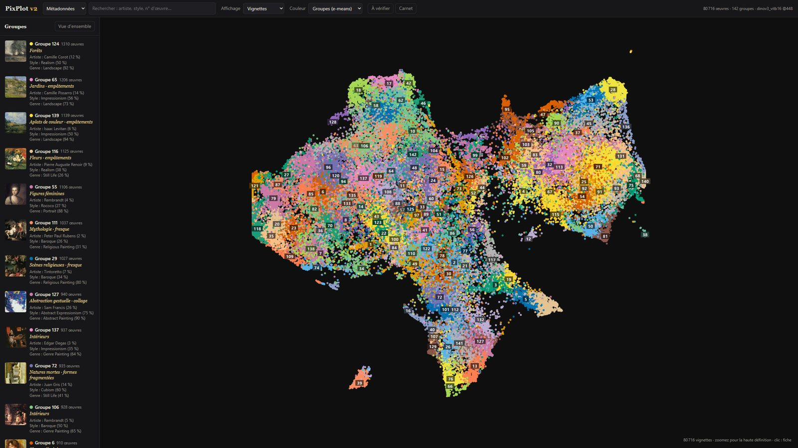
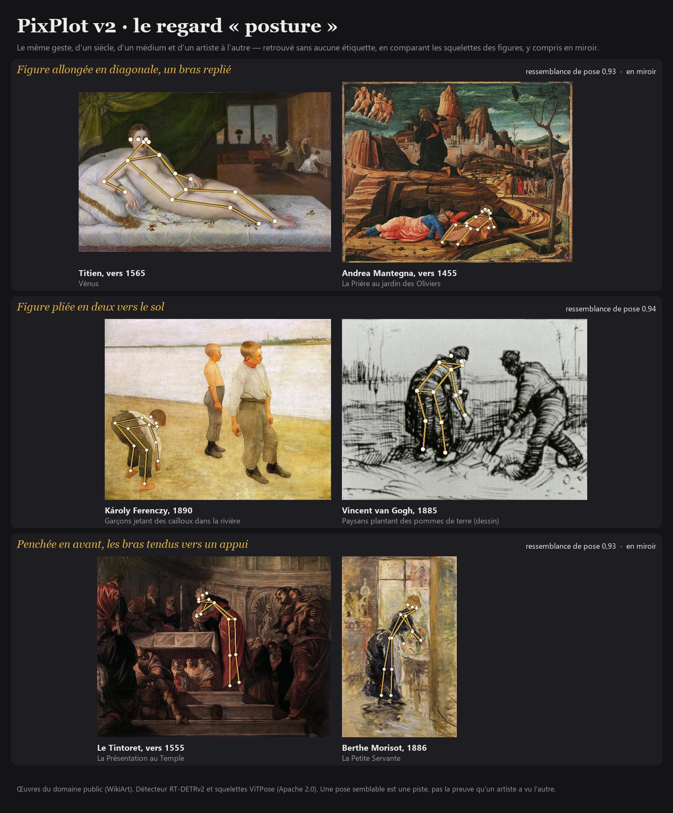

<p align="center">
  
</p>

<p align="center">
  <a href="README.md">English</a> · <b>Français</b> · <a href="https://riyadhhda.github.io/pixplot-v2/fr/"><b>Site du projet</b></a>
</p>

<p align="center">
  <a href="LICENSE"></a>
  <a href="https://github.com/riyadhHDA/pixplot-v2/releases"></a>
  <a href="https://doi.org/10.5281/zenodo.24363789"></a>
  <a href="https://github.com/riyadhHDA/pixplot-v2/actions/workflows/tests.yml"></a>
  
  
  
  
</p>

# PixPlot v2

PixPlot v2 est un outil local pour explorer de grands corpus d'œuvres d'art par ressemblance visuelle. Il reprend
l'idée du [PixPlot](https://github.com/YaleDHLab/pix-plot) du Yale DHLab (2018), réécrit de zéro autour des modèles
de vision récents (DINOv3, SigLIP 2) pour tourner sur un simple PC de bureau.

Le logiciel calcule des voisinages sur des pixels : il ne prouve ni influence ni attribution. L'idée est de séparer
les rôles : PixPlot calcule et organise, un assistant branché par MCP peut aider à chercher et comparer, et la
vérification reste côté historien.

## Ce que vous pouvez faire avec votre corpus

Partez d'un dossier d'images, d'une collection IIIF de musée ou d'un jeu de données comme WikiArt, avec ou sans
métadonnées. PixPlot répond alors à des questions d'historien de l'art. Les exemples viennent de WikiArt 81k ;
chaque résultat est une piste à vérifier, pas une conclusion.

| Votre question | Ce que fait PixPlot | Exemple sur WikiArt |
|---|---|---|
| **Qui a copié, cité ou repris qui ?** | Plus proches voisines selon quatre regards, comparateur et bouton « Pourquoi ? » qui montre les zones qui se répondent. | *Le Semeur* de Van Gogh retrouve celui de Millet au 1ᵉʳ rang ; la copie de Rubens d'après l'*Enlèvement d'Europe* de Titien aussi. |
| **Où revient ce motif ?** | Recherche d'un **détail** tracé sur une image, ou d'une **zone décrite** par des mots, dans 1,6 million de zones. | « Une auréole », « un crâne », « une main qui bénit » : la zone exacte est encadrée dans chaque œuvre trouvée. |
| **Quelles œuvres traitent ce thème ?** | Recherche en **phrase libre** (français ou anglais) et **axes conceptuels** : tout le corpus placé entre deux mots. | « Annonciation dans un jardin » ; le corpus rangé entre « sacré » et « profane ». |
| **Mon catalogue est-il fiable ?** | Liste **À vérifier** des étiquettes contredites par toutes les voisines, et repérage des **doublons**. | 4 884 étiquettes à vérifier ; 839 œuvres entrées deux fois, dont 702 sous deux styles différents (un même Corot « romantique » et « réaliste »). |
| **Qu'est-ce qui rapproche ces deux œuvres ?** | Le même couple vu par la forme, le sujet, la couleur et la touche ; les **désaccords** entre regards (même composition, sujet différent…). | Une mise en page reprise pour un autre thème ; un même sujet traité par deux mains. |
| **De quoi mon corpus est-il fait ?** | Carte de groupes nommés (vocabulaire d'histoire de l'art et **Iconclass**), **filtres combinés**, vues chronologique et géographique, bilan de ce qui manque. | « Baroque » + « portrait » = 980 œuvres, allumées sur la carte en 14 ms. |
| **Comment garder la trace de ma recherche ?** | **Carnet de recherche**, export en **Research Pack** (.zip : images, métadonnées sourcées, scores, méthode, fiche de données du corpus) et assistant branché par **MCP** qui cherche et compare avec vous. | Un dossier prêt pour un séminaire, un mémoire ou une relecture par un collègue. |
| **Quel modèle voit quoi ?** | Bancs d'essai sur des paires validées par l'historien ; chaque modèle a une fiche (données d'entraînement, biais). | Quatre modèles écartés après mesure (TIPSv2, PE-Spatial, SSCD, Depth Anything), chiffres publiés (ARCHITECTURE § 19, 24, 27, 28). |

## WikiArt complet sur un seul PC


Tout WikiArt (**80 716 œuvres**, 81 444 images, 33,7 Go) passe de bout en bout en **≈ 1 h 21** sur un PC sous
Windows 11 avec une AMD Radeon RX 7900 GRE et 16 Go de RAM : ingestion, vecteurs DINOv3 et SigLIP 2, index de
1,58 million de zones, regroupement, carte, audit à l'aveugle et banc d'essai. L'Atlas s'ouvre en environ 3 secondes
avec toutes les vignettes affichées, et une recherche par texte ou par détail répond en 0,25 s.

<details>
<summary>La carte entière : 142 groupes colorés</summary>


</details>

## Le même geste, d'un siècle à l'autre



Le regard « posture » (en essai) repère les figures, estime leur squelette et compare les poses, y compris en
miroir. Sans aucune étiquette, il rapproche une *Vénus* de Titien de l'apôtre endormi de Mantegna, ou un enfant
de Ferenczy d'une paysanne dessinée par Van Gogh : des formules gestuelles (les *Pathosformeln* d'Aby Warburg)
que les autres regards ne voient pas. Sur 37 paires « même geste » qu'il a proposées, 25 ont été validées à la
relecture ; dans l'Atlas, choisir le regard « Posture » dessine les squelettes qui se répondent. Une pose
semblable reste une piste, pas la preuve qu'un artiste a vu l'autre
([ARCHITECTURE §§ 35 et 41](ARCHITECTURE.fr.md)).

## Fonctions principales

| | |
|---|---|
| **Quatre regards séparés** | **Forme** (DINOv3 : silhouettes, composition), **sujet** (SigLIP 2 : thème, genre, école), **couleur** (palette CIELAB) et **touche** (facture et trait via la couche 6 de DINOv3). Croiser les regards aide à comprendre ce qui rapproche ou sépare deux œuvres. |
| **Recherche** | Par métadonnées, par **phrase libre** en français ou en anglais (SigLIP 2), par **zone décrite** (« une auréole », « un crâne » sur 1,6 M de zones) ou par **détail** en traçant un cadre directement sur une image. |
| **Groupes** | Regroupement sphérique (e-means) et communautés Leiden emboîtées, avec noms proposés à partir d'un vocabulaire d'histoire de l'art (à relire). |
| **Atlas web** | Carte interactive (deck.gl, hors ligne), fiches aux métadonnées sourcées et **mesures visuelles** sans GPU (équilibre, symétrie, entropie chromatique, d'après Stork), **comparateur** jusqu'à six œuvres avec bouton « Pourquoi ? », **filtres combinés** (artiste, style, genre, groupe…), **carnet de recherche**, une carte par regard, **axes conceptuels 2D** sur deux mots (façon *2D CLIP*), vues **chronologique** et **géographique** (lieux typés et datés, fond de carte embarqué). |
| **Audit du catalogue** | Audit à l'aveugle (pixels seuls), liste **À vérifier** des œuvres dont l'étiquette est contredite par toutes leurs voisines (erreur de catalogue ou œuvre singulière) et **doublons** : les œuvres entrées deux fois et leurs variantes (`pixplot doublons`). |
| **Collections IIIF** | `pixplot import-iiif` importe n'importe quel manifeste ou collection IIIF v2/v3 avec métadonnées normalisées et mention des droits. |
| **Serveur MCP (20 outils)** | Branche Claude ou un autre assistant compatible : recherche, affichage des images et des recadrages, comparaisons, mesures visuelles, axes conceptuels et ajout de notes dans le carnet. |
| **Traçabilité** | Chaque calcul est rangé dans un *run* daté (`manifest.json` avec modèle, paramètres et run parent). L'export en *Research Pack* (.zip) rassemble images, métadonnées sourcées et scores. |

## Quelques mesures sur WikiArt

Sur les 80 716 œuvres ([ARCHITECTURE.fr.md § 11-12](ARCHITECTURE.fr.md#11-passage-à-léchelle--wikiart-complet-16112026)),
part des 10 plus proches voisines qui portent la même étiquette que l'œuvre de départ :

| Regard | artiste | style | genre | Pointillisme | Fauvisme |
|---|---|---|---|---|---|
| forme (DINOv3) | 33,9 % | 52,4 % | 76,8 % | 21 % | 20 % |
| sujet (SigLIP 2) | **42,9 %** | **62,0 %** | **79,5 %** | 44 % | 26 % |
| touche | 35,0 % | 49,6 % | 62,8 % | **62 %** | **30 %** |

Colonne « artiste » recalculée le 19/11/2026 sur 1 090 artistes, après avoir retrouvé l'artiste de
35 185 œuvres « Unknown Artist » grâce à MMArt ([§ 34](ARCHITECTURE.fr.md)) : la tâche est plus dure
qu'avec 129 artistes (avant : 50,8 / 61,6 / 53,0 %), le classement des regards ne change pas.

- Sur un modèle purement visuel, le sujet prend vite le dessus sur la manière ; SigLIP 2 retrouve le mieux les catégories usuelles de la discipline.
- La **touche** rattrape bien les styles définis par la facture (Pointillisme : 21 % → 62 %) et reconnaît mieux la main de l'artiste que la forme globale.
- Les étiquettes de WikiArt contiennent pas mal d'erreurs : l'audit fait remonter des scènes religieuses classées en scènes de genre, par exemple.
- HDBSCAN ne passe pas l'échelle sur un continuum aussi dense ; le score d'atypicité reste le signal le plus fiable pour isoler les cas à part.

## Démarrage rapide

```bash
python -m venv .venv
.venv\Scripts\activate                 # Linux / macOS : source .venv/bin/activate
pip install -e ".[dev,ml]"             # installer PyTorch avant (roues ROCm d'AMD) : docs/INSTALL_GPU.fr.md
pytest

pixplot ingest "D:/MesImages"          # catalogue, vignettes, doublons
pixplot import-metadata meta.csv       # artiste, date, style… (colonne « path » obligatoire)
pixplot embed                          # vecteurs DINOv3 (GPU), reprenable
pixplot analyze                        # groupes, carte UMAP, voisinages
pixplot serve --open                   # ouvre l'Atlas sur http://127.0.0.1:8765
```

Pour lancer toute la chaîne d'un coup avec un journal chronométré : `bash scripts/full_pipeline.sh data/mon_corpus "Ma source"`.

<details>
<summary>Toutes les commandes</summary>

```bash
pixplot doctor                          # Python, PyTorch, GPU
pixplot import-iiif URL --out D:/Musee  # collection de musée (manifeste ou collection IIIF v2/v3)
pixplot embed --encoder siglip2_so400m  # espace texte↔image (« sujet »)
pixplot embed --encoder dinov3_vitb16_texture   # espace « touche »
pixplot embed --encoder color_lab       # espace « couleur » (sans GPU)
pixplot embed --encoder colorhist       # tout le pipeline sans GPU, pour tester
pixplot index [--encoder NOM]           # index FAISS du dernier run
pixplot index --regions                 # index des zones → « Chercher un détail » dans l'Atlas
pixplot maps                            # une carte UMAP par regard (sujet, couleur, touche)
pixplot communities                     # groupes Leiden emboîtés (familles ⊃ groupes) pour chaque regard
pixplot disagreements                   # paires qu'un regard rapproche et qu'un autre sépare
pixplot zonebench                       # chercher une zone avec des mots : banc d'essai RichArt
pixplot zones                           # index des zones (20 par œuvre, SigLIP 2) : « une auréole », « un crâne »
pixplot corpus                          # bilan critique : ce qui manque au corpus, ce que voit chaque regard
pixplot places --derive                 # lieux typés et datés déduits des métadonnées (musée, naissance…)
pixplot import-places lieux.csv         # lieux typés et datés d'un fichier (création, exposition, conservation…)
pixplot name-groups                     # nommer les groupes (SigLIP 2 + vocabulaire d'histoire de l'art)
pixplot suspects                        # étiquettes que toutes les voisines contredisent
pixplot search-text "Annonciation dans un jardin"
pixplot similar 42 --html planche.html  # œuvres les plus proches, en planche HTML
pixplot audit                           # audit à l'aveugle face aux étiquettes
pixplot bench                           # comparer des runs (étiquettes, paires connues)
pixplot pairs generate | bench          # banc d'essai par paires : quel regard pour quelle ressemblance
pixplot pack --text "Annonciation" -k 20 --question "…"   # Research Pack (.zip)
pixplot corpus --datasheet                                 # fiche de données du corpus (provenance, droits, manques)
pixplot mcp                             # serveur MCP : voir docs/MCP.fr.md
pixplot status
```
</details>

## Documentation

- [**Guide pratique**](https://riyadhhda.github.io/pixplot-v2/fr/guide/) : lire les scores, trois cas d'usage (filiation, étiquette, motif), brancher un assistant, citer ([English](https://riyadhhda.github.io/pixplot-v2/guide/))
- [ARCHITECTURE.fr.md](ARCHITECTURE.fr.md) : conception, bancs d'essai et mesures détaillées ([English](ARCHITECTURE.md))
- [docs/INSTALL_GPU.fr.md](docs/INSTALL_GPU.fr.md) : GPU sous Windows 11 (AMD ROCm), secours WSL2, poids des modèles ([English](docs/INSTALL_GPU.md))
- [docs/MCP.fr.md](docs/MCP.fr.md) : brancher Claude ou un autre assistant ([English](docs/MCP.md))
- [docs/FORMATS.fr.md](docs/FORMATS.fr.md) : ce que PixPlot écrit sur le disque, fichier par fichier ([English](docs/FORMATS.md))
- [docs/COMMANDS.fr.md](docs/COMMANDS.fr.md) : toutes les commandes `pixplot`, par étape de travail ([English](docs/COMMANDS.md))
- [ROADMAP.fr.md](ROADMAP.fr.md) : suite prévue, critères de réussite et essais écartés ([English](ROADMAP.md))
- [CHANGELOG.fr.md](CHANGELOG.fr.md) : historique des versions ([English](CHANGELOG.md))

Le code est commenté en français ; la documentation existe en français et en anglais.

## Choix techniques

- **Tout reste en local :** aucune image ne part vers un serveur distant, pas de télémétrie.
- **Images entières :** jamais de recadrage carré avant calcul (un letterbox préserve le format et la composition).
- **Calculs traçables :** chaque run garde son modèle, sa version et ses paramètres.
- **Mesurer avant d'ajouter :** les modèles qui ne battent pas l'existant sur les bancs d'essai (TIPSv2, PE-Spatial) sont documentés et retirés.

## Auteur

**Riyadh HADJBA**, étudiant en histoire de l'art à l'[Université de Strasbourg](https://www.unistra.fr).
Projet conçu et dirigé par Riyadh HADJBA, développé avec l'aide d'assistants de code (Claude et Gemini).

## Citer PixPlot v2

> Riyadh HADJBA, *PixPlot v2 : un laboratoire d'exploration visuelle pour l'histoire de l'art*,
> logiciel, Université de Strasbourg, 2026. DOI : [10.5281/zenodo.24363789](https://doi.org/10.5281/zenodo.24363789).

Ce DOI couvre toutes les versions ; chaque release a aussi le sien sur
[Zenodo](https://doi.org/10.5281/zenodo.24363789). Les formats APA et BibTeX sont disponibles via le bouton
« Cite this repository » de GitHub ([`CITATION.cff`](CITATION.cff)).

## Licence et crédits

Distribué sous licence **GPL-3.0** ([LICENSE](LICENSE)).

- Inspiré de [PixPlot](https://github.com/YaleDHLab/pix-plot) (Yale DHLab, MIT), réécrit de zéro sans reprendre son code.
- Modèles : [DINOv3](https://github.com/facebookresearch/dinov3) (Meta, licence DINOv3, poids jamais redistribués ici), [SigLIP 2](https://huggingface.co/google/siglip2-so400m-patch16-384) (Google, Apache 2.0).
- Bibliothèques : FAISS et e-means (Meta, MIT), UMAP, scikit-learn, deck.gl, FastAPI, SDK Python MCP. Fond de carte : [world-atlas](https://github.com/topojson/world-atlas) (ISC), d'après [Natural Earth](https://www.naturalearthdata.com) (domaine public).
- Vocabulaire des noms de groupes complété d'après le glossaire de H. Honour et J. Fleming, *The Visual Arts: A History* (7e éd. révisée, 2023) — seuls les termes sont repris.
- Lectures qui ont orienté les choix du projet : A. Wasielewski, *Computational Formalism* (MIT Press, 2023) ; B. Joyeux-Prunel, « ARTL@S » (*Artl@s Bulletin*, 2012) ; T. Arnold et L. Tilton, *Distant Viewing* (MIT Press, 2023) ; H. Honour et J. Fleming, *The Visual Arts: A History* (2023) ; L. Impett et F. Offert, « There Is a Digital Art History » (*Visual Resources*, 2024) ; D. G. Stork, *Pixels & Paintings: Foundations of Computer-assisted Connoisseurship* (Wiley, 2024) ; J.-L. Giavitto et P. Saint-Germier (dir.), *L'art au temps de l'IA* (Centre Pompidou, 2025).
- Banc d'essai des zones : [RichArt](https://huggingface.co/datasets/MihaiBogdanBindila/RichArt) (ICMR 2026, CC BY-NC 4.0, usage local uniquement) ; [TIPSv2](https://huggingface.co/google/tipsv2-b14) (Google DeepMind, Apache 2.0), testé puis écarté.
- Corpus d'essai : [WikiArt via huggan/wikiart](https://huggingface.co/datasets/huggan/wikiart) et le [Yale Center for British Art](https://britishart.yale.edu/) (domaine public, IIIF). Aucune image de corpus n'est versionnée ici.
