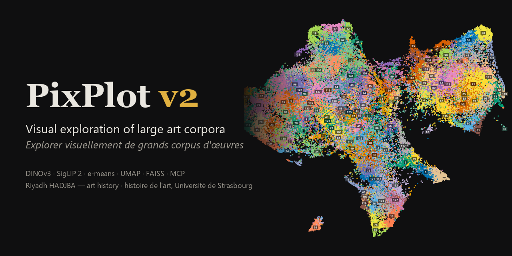
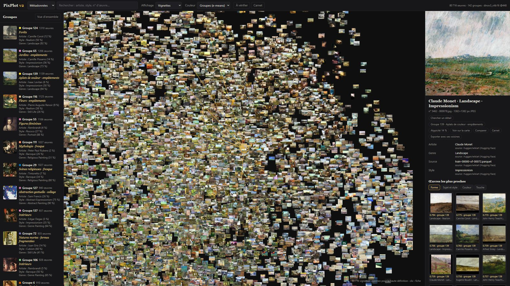
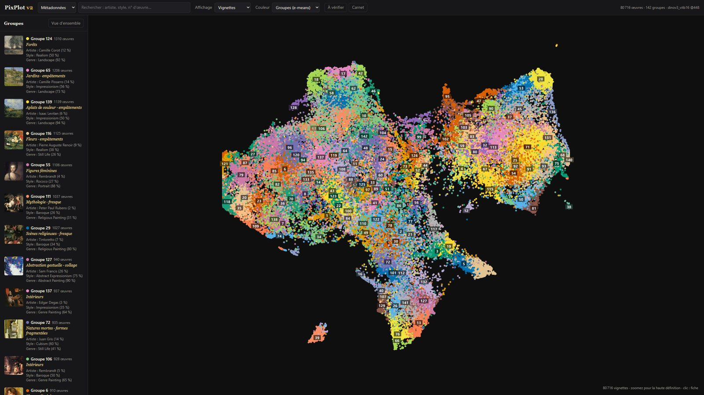

<p align="center">
  
</p>

<p align="center">
  <b>English</b> · <a href="https://riyadhhda.github.io/pixplot-v2/"><b>Website</b></a> · <a href="README.fr.md">Français</a>
</p>

<p align="center">
  <a href="LICENSE"></a>
  <a href="https://github.com/riyadhHDA/pixplot-v2/releases"></a>
  
  
  
  
</p>

# PixPlot v2

**A visual exploration lab for art history.** PixPlot v2 maps tens or hundreds of thousands
of artworks by resemblance, finds formal kinships and recurring details, and hands its
findings to a language model (through MCP or exportable *Research Packs*) without ever
losing track of where each result comes from.

> **Roles.** PixPlot computes, observes and organises. The language model asks questions
> and makes suggestions. The art historian checks, interprets and builds knowledge.

It is a ground-up rewrite inspired by Yale DHLab's [PixPlot](https://github.com/YaleDHLab/pix-plot)
(2018), built on current vision models and designed to run on a single consumer PC.

## The full WikiArt corpus, on one PC



**80,716 artworks** from WikiArt (81,444 images, 33.7 GB) processed end to end in
**about 1 h 21** on an AMD Radeon RX 7900 GRE under Windows 11 with 16 GB of RAM: ingestion,
DINOv3 and SigLIP 2 embeddings, indexes for 1.58 million image regions, clustering, map,
blind audit and benchmark. In the Atlas, every thumbnail is on screen at once, the map loads
in about 3 seconds and a text or detail search answers in 0.25 s.

<details>
<summary>The map as a whole: 142 groups, coloured</summary>


</details>

## What it does

| | |
|---|---|
| **Four ways of seeing** | Neighbours by **form** (DINOv3: shapes, composition), **subject** (SigLIP 2: what you would describe in words), **colour** (CIELAB palette) and **touch** (brushwork and line, from DINOv3's middle layers). Comparing them says *why* two works look alike. |
| **Search** | By metadata, by **free-text description** in French or English (SigLIP 2), or by **detail**: draw a box around a hand, a drapery or an object and find similar regions across the corpus. |
| **Groups that name themselves** | Spherical e-means clusters, named from an art-history vocabulary, e.g. « Scènes religieuses · icône » (Fra Angelico), « Batailles · gravure » (Doré). These are suggestions, to be checked. |
| **Atlas** | Interactive deck.gl map with every thumbnail visible, artwork records with sourced metadata, **comparator** (up to six works side by side, similarity in each space), **research notebook**, **one map per way of seeing**, **timeline** and **geography** (offline world base map) layouts when dates or coordinates exist. Welcome screen, help and keyboard shortcuts; adapts to laptop screens. |
| **A critical eye on the catalogue** | A blind audit (models see only pixels) and a list of **labels to check**: works whose neighbours all disagree with their label, either a cataloguing error or a genuinely singular work. |
| **Museum collections** | `pixplot import-iiif` loads any IIIF v2/v3 manifest or collection (images at the requested size, normalised metadata, rights). |
| **Working with Claude** | An MCP server with 14 tools: Claude searches, **looks at the images and details**, compares, reads the groups and writes to your notebook, following prudent-interpretation guidelines. |
| **Traceability** | Every result is a versioned *run* (model, parameters, parent run). Research Packs (.zip) bundle images, sourced metadata, explicit relations and provenance for a colleague or another LLM. |

## What the experiments showed

Measured on the 80,716 WikiArt works ([ARCHITECTURE.md § 11–12](ARCHITECTURE.md#11-scaling-up-the-full-wikiart-corpus-16112026)),
share of the 10 nearest neighbours that share a work's label:

| Space | artist | style | genre | Pointillism | Fauvism |
|---|---|---|---|---|---|
| form (DINOv3) | 50.8 % | 52.4 % | 76.8 % | 21 % | 20 % |
| subject (SigLIP 2) | **61.6 %** | **62.0 %** | **79.5 %** | 44 % | 26 % |
| touch | 53.0 % | 49.6 % | 62.8 % | **62 %** | **30 %** |

- **Subject outweighs manner** for a purely visual model; the text–image space retrieves art-history categories best.
- **Touch** recovers styles defined by brushwork (Pointillism: 21 % → 62 %) and recognises the artist's hand better than form.
- **The labels themselves are sometimes wrong**: the audit surfaces real cataloguing errors (religious scenes filed as genre paintings).
- **HDBSCAN does not scale** on such a dense continuum; the atypicality score is the reliable signal for isolated works.

## Quick start

```bash
python -m venv .venv
.venv\Scripts\activate                 # Linux / macOS: source .venv/bin/activate
pip install -e ".[dev,ml]"             # install PyTorch first (AMD ROCm wheels): docs/INSTALL_GPU.md
pytest

pixplot ingest "D:/MyImages"           # catalogue, thumbnails, duplicates
pixplot import-metadata meta.csv       # artist, date, style… (needs a "path" column)
pixplot embed                          # DINOv3 embeddings (GPU), resumable
pixplot analyze                        # groups, UMAP map, neighbours
pixplot serve --open                   # the Atlas on http://127.0.0.1:8765
```

Or the whole pipeline in one go, with a timed log: `bash scripts/full_pipeline.sh data/my_corpus "My source"`.

<details>
<summary>All commands</summary>

```bash
pixplot doctor                          # Python, PyTorch, GPU
pixplot import-iiif URL --out D:/Museum # museum collection (IIIF manifest or collection, v2/v3)
pixplot embed --encoder siglip2_so400m  # text↔image space ("subject")
pixplot embed --encoder dinov3_vitb16_texture   # "touch" space
pixplot embed --encoder color_lab       # "colour" space (no GPU needed)
pixplot embed --encoder colorhist       # whole pipeline without a GPU, for testing
pixplot index [--encoder NAME]          # FAISS index of the latest run
pixplot index --regions                 # region index → "Search a detail" in the Atlas
pixplot maps                            # one UMAP map per way of seeing (subject, colour, touch)
pixplot communities                     # nested Leiden groups (families ⊃ groups) for each way of seeing
pixplot disagreements                   # pairs one way of seeing brings together and another pulls apart
pixplot name-groups                     # name the groups (SigLIP 2 + art-history vocabulary)
pixplot suspects                        # labels contradicted by all neighbours
pixplot search-text "Annunciation in a garden"
pixplot similar 42 --html sheet.html    # nearest works as an HTML contact sheet
pixplot audit                           # blind audit against the labels
pixplot bench                           # compare runs (labels, known pairs)
pixplot pairs generate | bench          # pair benchmark: which way of seeing finds which resemblance
pixplot pack --text "Annunciation" -k 20 --question "…"   # Research Pack (.zip)
pixplot mcp                             # MCP server: see docs/MCP.md
pixplot status
```
</details>

## Documentation

- [ARCHITECTURE.md](ARCHITECTURE.md): design, layers, roadmap, benchmarks and the findings above ([français](ARCHITECTURE.fr.md))
- [docs/INSTALL_GPU.md](docs/INSTALL_GPU.md): GPU setup on Windows 11 (AMD ROCm), WSL2 fallback, models ([français](docs/INSTALL_GPU.fr.md))
- [docs/MCP.md](docs/MCP.md): connecting Claude or another LLM ([français](docs/MCP.fr.md))
- [ROADMAP.md](ROADMAP.md): what comes next, in order, and what makes each step a success ([français](ROADMAP.fr.md))
- [CHANGELOG.md](CHANGELOG.md): version history. "v2" is the project's name; software versions run from 0.1 to 0.10 and follow semantic versioning ([français](CHANGELOG.fr.md))

The code comments and the interface are in French; the documentation is in both languages.

## Principles

**Local first:** no image leaves your computer, no telemetry. **Whole images:** never cropped
before analysis (letterboxing preserves the composition). **Traceable and reproducible:**
every result records its model, version and parameters. **Uncertainty is explicit:** a
similarity score is a lead, not proof of influence or attribution.

## Author

**Riyadh HADJBA**, art history student at the [University of Strasbourg](https://www.unistra.fr).
PixPlot v2 was designed and directed by Riyadh HADJBA and written with the help of Claude (Anthropic).

## Licence and credits

PixPlot v2 is released under the **GPL-3.0** licence (see [LICENSE](LICENSE)).

- Inspired by [PixPlot](https://github.com/YaleDHLab/pix-plot) (Yale DHLab, MIT); rewritten from scratch, the original code is not included.
- Models: [DINOv3](https://github.com/facebookresearch/dinov3) (Meta, DINOv3 licence, weights on request and never redistributed here), [SigLIP 2](https://huggingface.co/google/siglip2-so400m-patch16-384) (Google, Apache 2.0).
- Libraries: FAISS and e-means (Meta, MIT), UMAP, scikit-learn, deck.gl, FastAPI, the MCP Python SDK. World base map: [world-atlas](https://github.com/topojson/world-atlas) (ISC), from [Natural Earth](https://www.naturalearthdata.com) (public domain).
- Group-naming vocabulary extended from the glossary of H. Honour and J. Fleming, *The Visual Arts: A History* (revised 7th ed., 2023): only the terms are used.
- Test corpora: [WikiArt via huggan/wikiart](https://huggingface.co/datasets/huggan/wikiart) and the [Yale Center for British Art](https://britishart.yale.edu/) (public domain, IIIF). No corpus images are stored in this repository; the screenshots show the Atlas interface.
